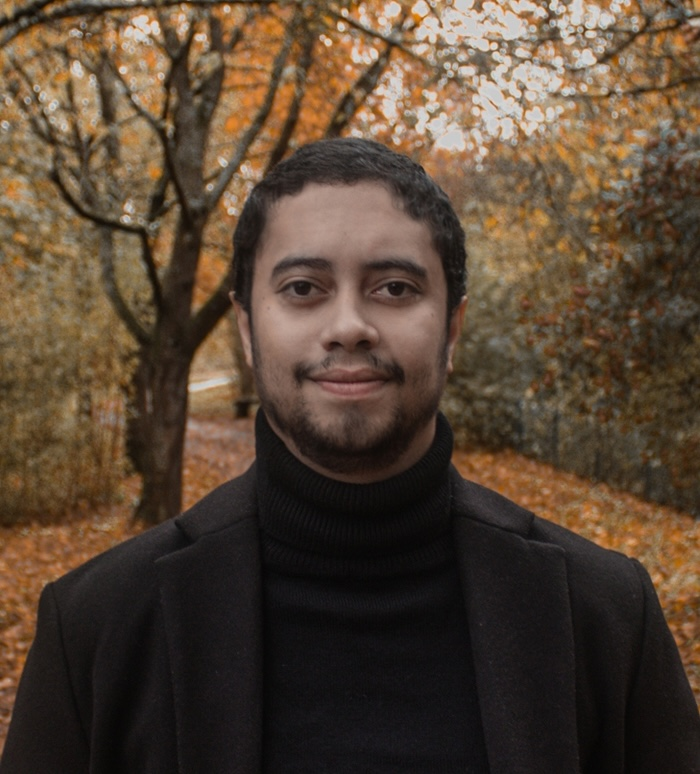

Jean de Oliveira

<strong>PhD Candidate in Economics</strong> Goethe University Frankfurt

I am a PhD candidate at Goethe University Frankfurt. I work on the economics of deforestation, with a special focus on Indigenous territories of the Amazon. My research asks how land rights and the financial system shape what happens to forests, combining administrative records with spatial data. I also study household beliefs and expectations, and how they shape financial decisions.

Contact: <a href="mailto:jeanoli@stud.uni-frankfurt.de">jeanoli@stud.uni-frankfurt.de</a>

<a href="cv.pdf" class="cv-link">Curriculum Vitae</a>

---

## Working Papers

::: {.paper}
[**Branches and Roots: Bank Presence and Forest Preservation in Amazonian Indigenous Lands**]{.paper-title}

[Job Market Paper]{.jmp-label}

[With Douglas K.G. Araujo]{.paper-authors}

[Indigenous lands shelter a large portion of the Brazilian Amazon's intact forest, yet illegal deforestation inside their boundaries has been climbing despite legal protection. We exploit the expansion and subsequent contraction of the bank-branch network between 2008 and 2024 in the traditionally underbanked Amazon to analyze whether local banking presence affects deforestation inside nearby Indigenous lands. Using branch dynamics in surrounding municipalities as instrumental variables, we find that each additional branch near an Indigenous land lowers cumulative forest loss inside that area by roughly 2.7 km² within three years. We then show that this effect runs through local social capital. New branches also bring more restaurants, bars and supermarkets, the everyday venues where social ties form.]{.paper-summary}

[PDF](papers/branches-and-roots.pdf){.paper-btn .paper-btn--pdf} [Interactive Online Appendix](appendix-branches-and-roots/){.paper-btn}
:::

::: {.paper}
[**Actual and Perceived Financial Knowledge over the Life Cycle**]{.paper-title}

[What happens when households believe they know more than they actually do about financial matters? I use causal evidence to show that overconfidence leads households to drain their retirement savings early, fall behind on their mortgages, and lean too heavily on credit cards. A calibrated life-cycle model then traces how the damage compounds across the working years and lands hardest in the retirement years.]{.paper-summary}

[PDF](papers/actual-perceived-financial-knowledge.pdf){.paper-btn .paper-btn--pdf}
:::

## Work in Progress

::: {.paper}
[**Carbon Contracting on Brazilian Indigenous Lands**]{.paper-title}
:::

::: {.paper}
[**Too Uncertain to Listen: Trust and the Updating of Household Inflation Expectations**]{.paper-title}

[With Michael Haliassos and Johannes Zahner]{.paper-authors}
:::

::: {.paper}
[**Causal Effects of War Framing on Inflation Expectations**]{.paper-title}

[With Michael Haliassos and Johannes Zahner]{.paper-authors}
:::

---

## Publications

*In Engineering*

**New Technologies for Newborn Safety**

::: {.publication}
[[Patent]]{.patent-label} [**Oral Feeding Readiness Prediction System for Neonates.**](https://doi.org/10.8080/1020240010931)
Korean Intellectual Property Office, 2024.
:::

::: {.publication}
[**Quantitative non-nutritive sucking measurement as a predictor of oral feeding readiness in newborns.**](https://www.frontiersin.org/articles/10.3389/fped.2023.1143416/full) (*Frontiers in Pediatrics*, 2023)

[With Kyeong Jae Lee, Yong Beom Shin, Ho Eun Park, Suro Choi, Daun Hong, Sohee Kim, and Jin A Yoon]{.paper-authors}
:::

::: {.publication}
[**A silver nanowire-based flexible pressure sensor to measure the non-nutritive sucking power of neonates.**](https://mnsl-journal.springeropen.com/articles/10.1186/s40486-020-00121-0) (*Micro & Nano Systems Letters*, 2020)

[With Tausif Muhammad and Sohee Kim]{.paper-authors}
:::
